# BÁO CÁO BÀI TẬP THỰC HÀNH C# WINFORMS (3-TIER ARCHITECTURE)

## MỤC 1: THÔNG TIN SINH VIÊN
* **Họ và tên sinh viên:** Nguyễn Hữu Trường
* **Mã sinh viên:** 24810320290
* **Lớp / Khóa:** D19QTANM1

---

## MỤC 2: HÌNH ÁNH KẾT QUẢ CÁC MÀN HÌNH CHỨC NĂNG

---

### I. BÀI TẬP 6.6: HỆ THỐNG QUẢN LÝ MƯỢN TRẢ SÁCH THƯ VIỆN (LIBRARY MANAGEMENT SYSTEM)

1. **Màn hình Chính / Tổng quan hệ thống:**
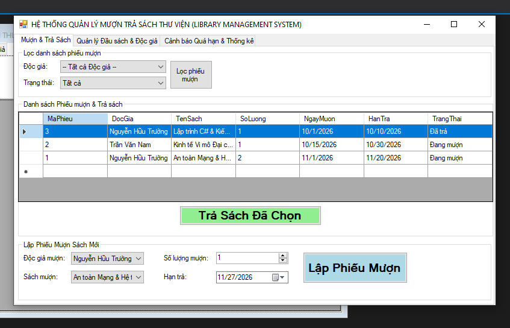

2. **Màn hình Quản lý Danh mục (CRUD - Đầu sách & Độc giả 3-Tier):**
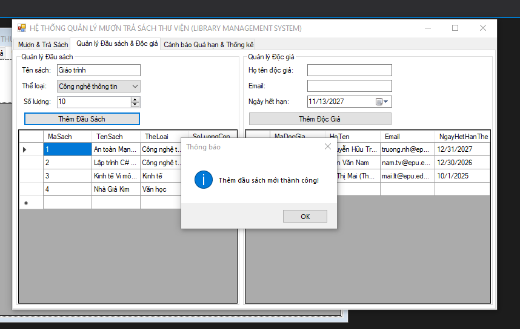

3. **Màn hình Thực thi Nghiệp vụ chính (Mượn / Trả sách & Cập nhật Tồn kho):**
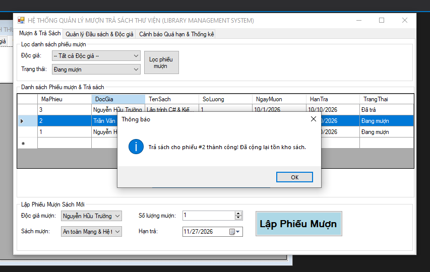

4. **Màn hình Báo cáo - Thống kê (Lượt mượn theo Thể loại - GROUP BY):**
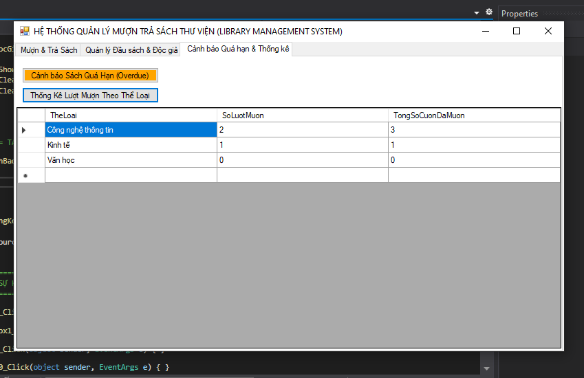

5. **Minh họa An toàn Dữ liệu (Kiểm tra Hạn thẻ & Cảnh báo Sách quá hạn):**
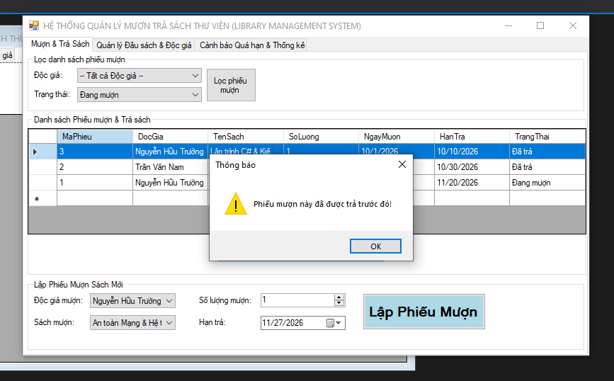

---

---

### II. BÀI TẬP 6.7: HỆ THỐNG QUẢN LÝ PHÒNG KHÁM & KÊ ĐƠN THUỐC (CLINIC & PHARMACY MANAGEMENT SYSTEM)

1. **Màn hình Chính / Tổng quan hệ thống:**
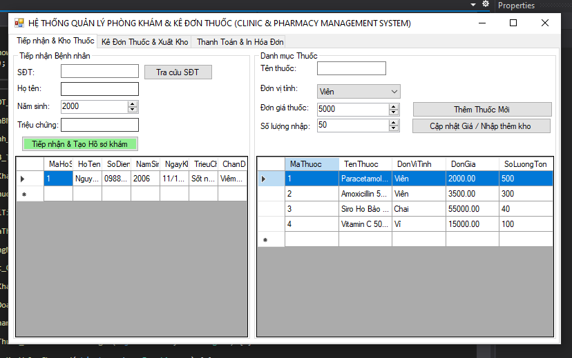

2. **Màn hình Quản lý Danh mục (CRUD - Tra cứu Bệnh nhân & Kho Dược):**
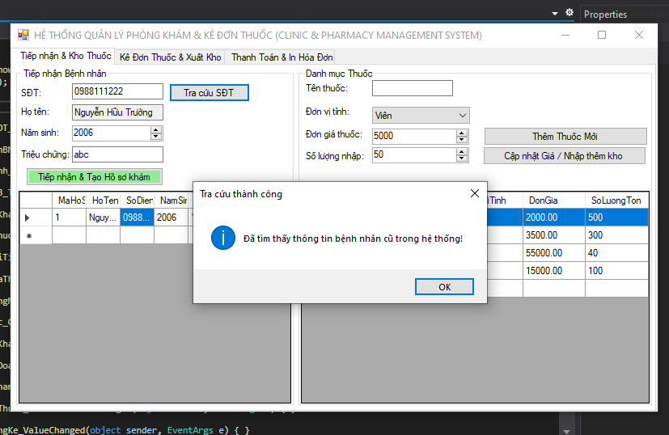

3. **Màn hình Thực thi Nghiệp vụ chính (Kê Đơn thuốc & Xuất kho Transaction):**
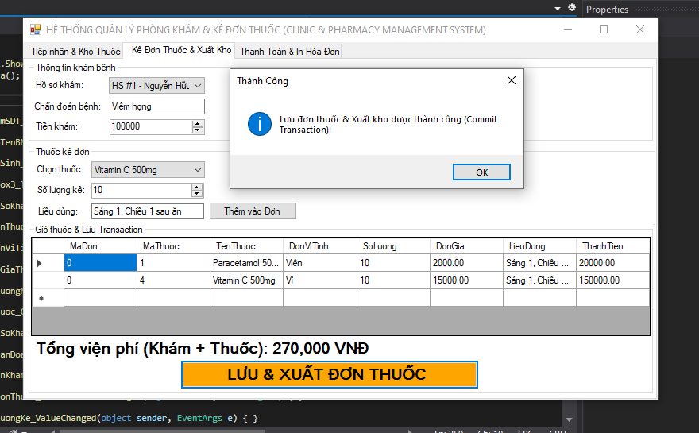

4. **Màn hình Báo cáo - Thống kê (Thanh toán & In Hóa đơn Viện phí):**
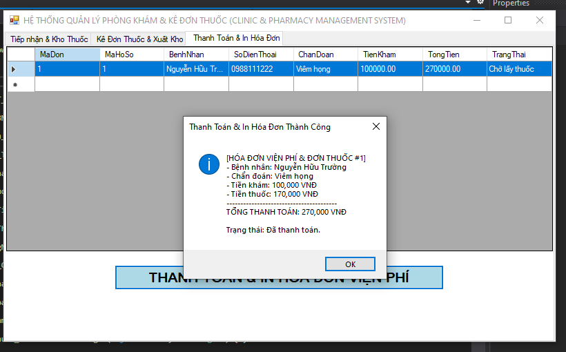

5. **Minh họa An toàn Dữ liệu (Báo lỗi Transaction Rollback khi thiếu Thuốc tồn kho):**
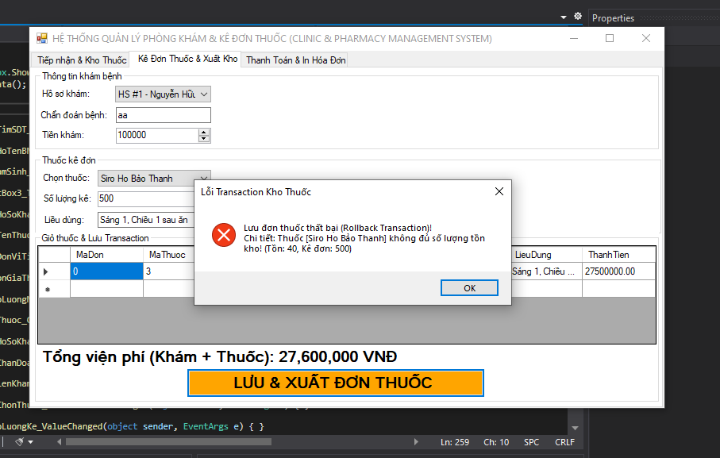

---

---

### III. BÀI TẬP 6.8: HỆ THỐNG QUẢN LÝ BÀN BIDA & DỊCH VỤ GIẢI TRÍ (BILLIARDS CLUB MANAGEMENT SYSTEM)

1. **Màn hình Chính / Sơ đồ Bàn Bida trực quan (Visual Table Grid):**
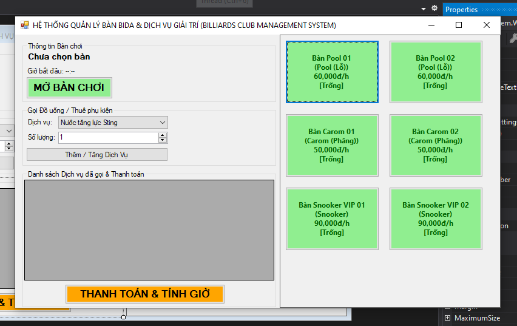

2. **Màn hình Quản lý Danh mục (CRUD - Chọn bàn & Mở bàn chơi):**
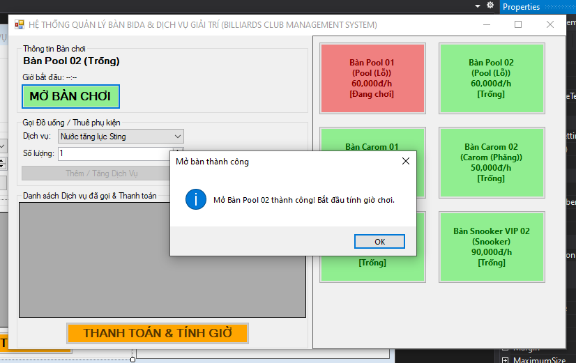

3. **Màn hình Thực thi Nghiệp vụ chính (Gọi Đồ uống / Thuê gậy ngắt kết nối):**
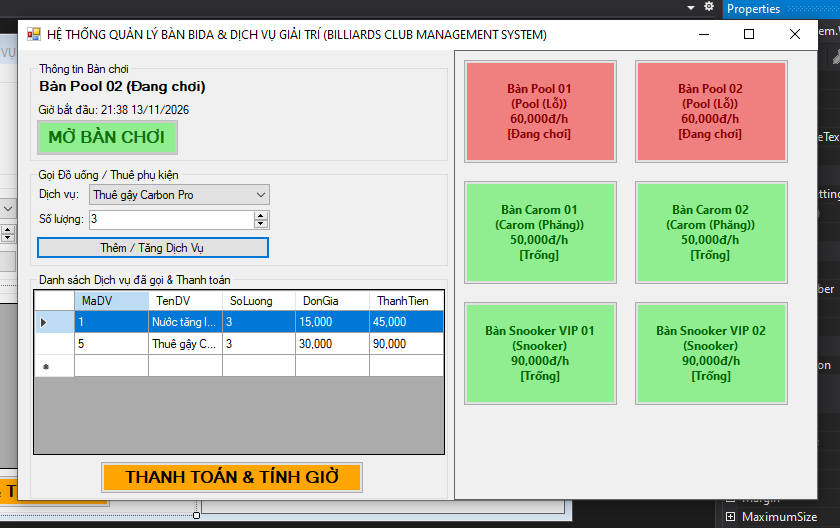

4. **Màn hình Báo cáo - Thống kê (Tính giờ tự động & Thanh toán Hóa đơn):**
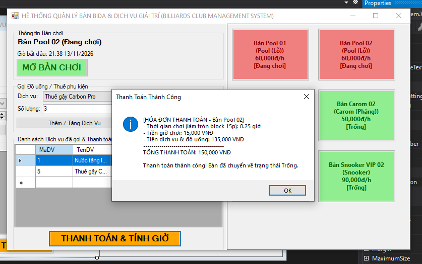

5. **Minh họa An toàn Dữ liệu (Báo lỗi Transaction Rollback khi thiếu Tồn kho):**
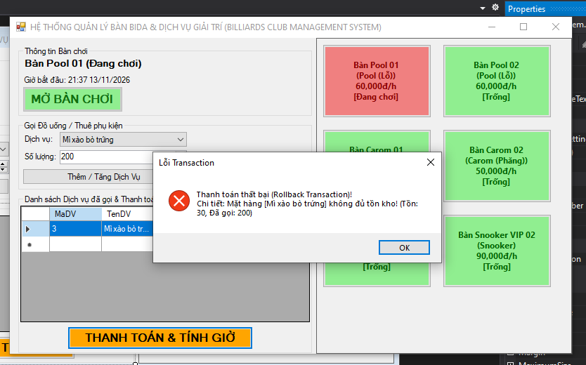